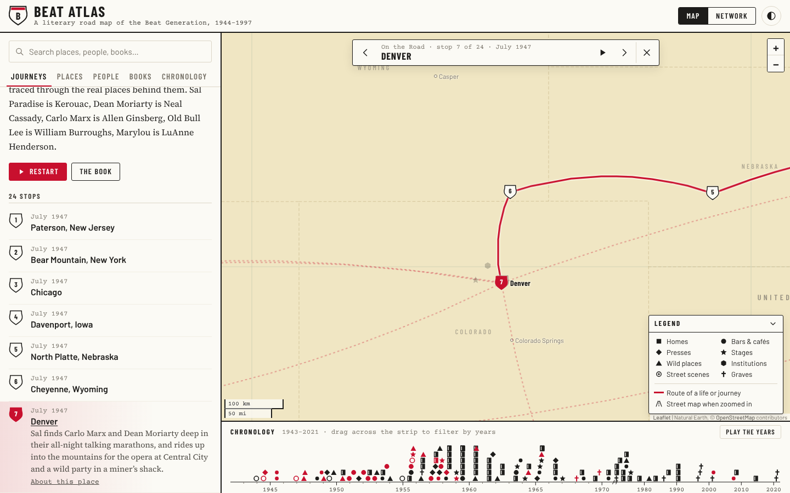
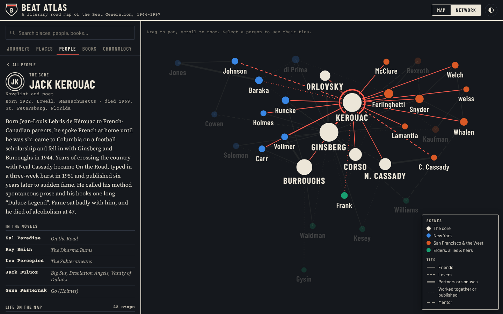

# Beat Atlas

An interactive literary map of the Beat Generation: the apartments, bars, bookshops, mountains, courtrooms and graves of Jack Kerouac, Allen Ginsberg, William S. Burroughs and their circle, 1944–1997, drawn like a mid-century road map.



## What's in it

| | |
|---|---|
| **96 places** | From Joan Vollmer's apartment on West 115th Street to the Beat Hotel in Paris, Villa Muniria in Tangier and the fire lookout on Desolation Peak, each with a short history. |
| **31 people** | Writers, muses and allies, with biographies, life paths drawn on the map, and the names they go by in the romans à clef (Dean Moriarty, Carlo Marx, Japhy Ryder…). |
| **61 books, magazines and films** | Where each was written, where it is set and where it was published. |
| **82 events** | Meetings, readings, arrests, trials, journeys and deaths, on a scrubbable chronology. |
| **6 journeys** | Guided routes you can play stop by stop: *On the Road*, *Howl*, *The Dharma Bums*, Burroughs's *Interzone* exile, Ginsberg's *Planet News* years, and Ken Kesey's bus *Further*. |

### Ways to explore

- **Map.** Places gather into town clusters at low zoom and split apart as you zoom in. Up close, OpenStreetMap streets appear under the pins. Toggle symbol types in the legend.
- **Journeys.** Press play and the map flies stop to stop, drawing the red line as it goes. Use ← and → to step.
- **People.** Selecting someone draws their life across the map as numbered route shields and dims everything else.
- **Chronology.** Drag across the strip under the map to show only the places active in those years, or press *Play the years* to watch the movement spread from Morningside Heights to North Beach to Tangier.
- **Network.** Who knew whom: friends, lovers, partners, collaborators and mentors, grouped by scene.
- **Search.** Press `/` and type a name, a place, a title, or a fictional alias.

Every view has its own link (for example `#person-kerouac`, `#place-six-gallery`, `#journey-howl`), so you can share exactly what you're looking at. The page follows your system's light or dark setting, and the toggle in the corner switches it.



## Running it

It's a static site with no build step and no dependencies to install.

- Open `index.html` directly in a browser, or
- serve the folder: `python3 -m http.server` and visit <http://localhost:8000>.

To publish it with GitHub Pages: **Settings → Pages → Build and deployment → Deploy from a branch**, pick the branch and the root folder.

## How it's built

```
index.html          page shell
css/atlas.css       all styles, light and dark palettes as CSS custom properties
js/core.js          data indexing, shared state, glyphs and route shields
js/map.js           Leaflet map: base layers, clustering, labels, routes, journey playback
js/timeline.js      D3 chronology strip with brushing and playback
js/network.js       D3 force-directed network
js/panel.js         the index: lists, search and detail pages
js/main.js          routing, view switching, theme, journey player
data/*.js           the content (see below)
data/geo.js         generated base geography
vendor/             Leaflet 1.9.4, D3 7.9.0, topojson-client 3.1.0
scripts/build-geo.cjs  rebuilds data/geo.js
```

The data files are plain JavaScript (`window.BEAT.places = [...]`) rather than JSON so the page works when opened from disk.

### Adding to the atlas

Each file in `data/` starts with a comment describing its fields. In short:

- **A place** (`data/places.js`) needs an `id`, `name`, `kind` (home, scene, press, stage, wild, institution, street or grave), `city`, `region`, `address`, `coords` as `[lat, lng]`, `years` as `[from, to]` (`to` may be `null`), the `people` connected to it, and a `text`. Add `approx: true` when only the town or neighborhood is known.
- **A person** (`data/people.js`) has a `group`, birth and death, `aliases` from the novels, and a `life` list of `[placeId, year, note]` that becomes their route on the map. Ties between people go in `BEAT.ties`.
- **A work** (`data/works.js`) lists the place ids where it was `written`, where it is `set`, and optionally the `press` that published it.
- **An event** (`data/events.js`) has a `date` (`YYYY`, `YYYY-MM` or `YYYY-MM-DD`), a `kind`, an optional `place` and its `people`.
- **A journey** (`data/journeys.js`) is a list of stops, each naming a place id or giving its own `at` coordinates.

Places, books and events link to each other automatically through these ids.

### Rebuilding the base map

`data/geo.js` holds Natural Earth countries, borders, lakes and reference towns, and U.S. state lines, as compact TopoJSON. To regenerate it, follow the steps at the top of `scripts/build-geo.cjs`.

## Sources and credits

The histories summarize the published record: biographies, memoirs and the works themselves. Street addresses were geocoded against OpenStreetMap and checked by hand; places known only to the town or neighborhood are marked approximate. Corrections are welcome.

For further reading: Ann Charters, *Kerouac*; Barry Miles, *Ginsberg* and *Call Me Burroughs*; Bill Morgan, *The Beat Generation in New York* and *The Beat Generation in San Francisco*; Joyce Johnson, *Minor Characters*; Carolyn Cassady, *Off the Road*; Hettie Jones, *How I Became Hettie Jones*.

- Base map: [Natural Earth](https://www.naturalearthdata.com/) (public domain) via [world-atlas](https://github.com/topojson/world-atlas); U.S. states from the U.S. Census Bureau via [us-atlas](https://github.com/topojson/us-atlas).
- Street maps: © [OpenStreetMap](https://www.openstreetmap.org/copyright) contributors, tiles from the OpenStreetMap Foundation's standard tile server, used under its [tile usage policy](https://operations.osmfoundation.org/policies/tiles/).
- Libraries: [Leaflet](https://leafletjs.com/) (BSD-2-Clause), [D3](https://d3js.org/) (ISC), [topojson-client](https://github.com/topojson/topojson-client) (ISC). Their licenses are in `vendor/`.
- Type: Barlow Condensed, Barlow, Courier Prime and Source Serif 4, via Google Fonts (SIL Open Font License).

Short quotations from the works are included for commentary.
